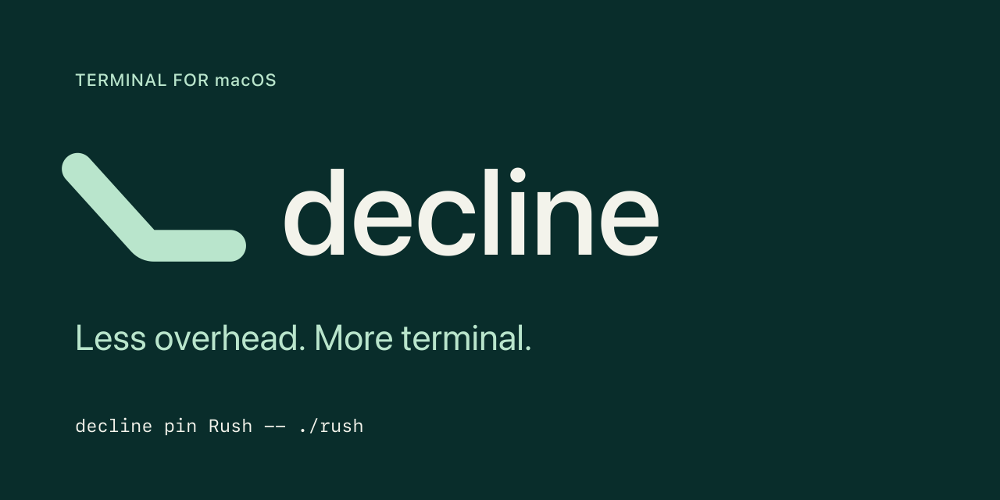
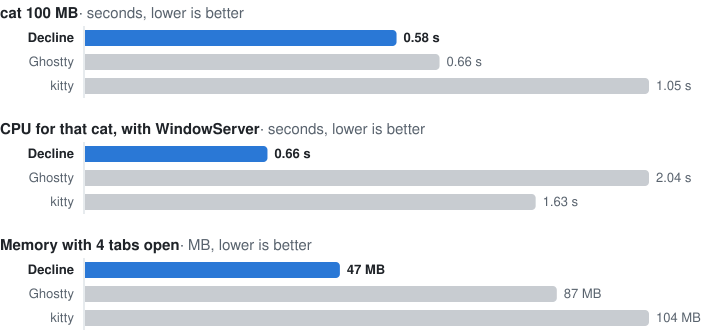

# Terminal Decline



Terminal Decline (Decline for short) is a GPU-accelerated terminal for
macOS, written in Rust. It aims to use less memory and CPU than Ghostty and
Warp, has no UI of its own, and can turn any program into its own Dock app.

- **Under half Ghostty's memory.** 26 MB idle against 60, 19 MB after
  10k lines against 56. Scrollback is kept as text and style runs,
  LZ4-compressed once it goes quiet.
- **Faster `cat`, on a third of the CPU.** 100 MB in 0.58 s (Ghostty
  0.66 s), using 0.66 s of CPU with WindowServer against Ghostty's 2.04 s.
- **Quiet when idle.** No timers, no redraws while nothing changes:
  0.02% CPU and about one wake-up every two seconds.
- **Native, with no UI of its own.** AppKit window tabs, splits, Core
  Text shaping (ligatures included) and Metal; settings are a config file
  or a Settings screen in a tab.
- **Current protocols.** kitty keyboard and graphics, Sixel and iTerm2
  images, OSC 8 links, OSC 133 prompt marks; checked against vttest and
  esctest2.
- **Terminals you can script.** `decline ctl` runs real terminals without
  windows: send keys, wait for text or for a command to finish (with its
  exit status), read the screen as JSON, screenshot it.
- **Any program as a Dock app.** `decline pin rush --dock` gives rush its
  own icon, opening straight into it.
- **Easy to move to.** `decline import ghostty` converts your Ghostty
  config, and the config reloads when you save it.

## Install

**Homebrew** (Apple Silicon; installs `Terminal Decline.app` and the
command as both `terminal-decline` and `decline`):

```sh
brew install --cask 0xdeafcafe/tap/terminal-decline
```

**From source, as a macOS app.** You need Rust (`rustup`, stable) and
the Xcode command line tools (`xcode-select --install`; the full Xcode
adds the Metal compiler, otherwise shaders compile at start). Then:

```sh
git clone https://github.com/0xdeafcafe/terminal-decline
cd terminal-decline
scripts/dogfood.sh --open
```

This builds a release, makes the app bundle (launcher, library and pin
stub), signs it and installs it as `~/Applications/Terminal Decline.app`,
then opens it. Drag it to the Dock to keep it there.

- To install somewhere else: `DECLINE_DOGFOOD_DIR=/Applications scripts/dogfood.sh --open`.
- To update: `git pull`, then `scripts/dogfood.sh` again. A running copy
  restarts into the new build and reopens its windows in the same folders
  and places.
- It is signed ad-hoc, so macOS asks again for permissions (files,
  notifications) after each rebuild. To keep them, sign with your own
  certificate: `DECLINE_DOGFOOD_IDENTITY="Developer ID Application: …" scripts/dogfood.sh`.
- The in-app updater stays off in these builds: updating is `git pull`.

**From source, as the bare command** (no app bundle, so no Dock pins made
from the app and no updater):

```sh
cargo install --locked --git https://github.com/0xdeafcafe/terminal-decline terminal-decline
```

macOS 14 (Sonoma) or later. Releases are Apple Silicon only; source builds
are tested on Apple Silicon. MIT licensed.

## Pin a program to the Dock

Any command can be its own Mac app, with its own Dock icon, windows and
settings. For example [rush](https://github.com/0xdeafcafe/rush), the
terminal app for coding agents (`brew install 0xdeafcafe/tap/rush`):

```sh
decline pin rush --dock
```

That makes `~/Applications/rush.app` and puts it in the Dock: clicking it
opens a Decline window running rush, nothing else. The icon is rush's
own if it ships one (an app bundle's, or `rush.png` / `rush.icns` beside
the program), else one is drawn for it; `--icon FILE` picks another.

```sh
decline pin Rush --icon rush.png --cwd ~/code -- rush   # Rush.app: its own name, icon and folder
decline pin --list                                      # your pins
decline pin --edit rush                                 # its settings (a config layer of its own)
decline pin --remove rush
```

Pins load the installed app, so they keep working after updates; their
settings are in `~/.config/terminal-decline/pins/`.

## Benchmarks

2 November 2026, Apple M1 Max, macOS 27.0. Decline at 7849ad4 (release
build; `cat` and idle CPU at 82c455f), Ghostty 1.4.0, kitty 0.49.2. Menlo 13, 100×30 cells, 10k lines
of scrollback, one window; memory is macOS physical footprint summed over
all the terminal's processes; medians of 5 runs, taken in turns, on a Mac
with other work running (load 3–6). Script:
[scripts/compare/run.py](scripts/compare/run.py).

| | idle memory | after 10k lines | 4 tabs | `cat` 100 MB | `cat` CPU (incl. WindowServer) | idle CPU | idle wakeups/s |
|---|---|---|---|---|---|---|---|
| **Decline** | **26 MB** | **19 MB** | **47 MB** | **0.58 s** | **0.66 s** | **0.02%** | **0.5** |
| Ghostty | 60 MB | 56 MB | 87 MB | 0.66 s | 2.04 s | 0.03% | 0.5 |
| kitty | 99 MB | 130 MB | 104 MB | 1.05 s | 1.63 s | 0.12% | 24 |

Warp and Terminal.app, measured the same way on 30 October, took 3.6 s
and 4.0 s for the `cat` and 310–333 MB and 48–139 MB of memory:
[docs/comparison-2026-10-30.md](docs/comparison-2026-10-30.md).

<picture>
  <source media="(prefers-color-scheme: dark)" srcset="docs/img/bench-dark.svg">
  
</picture>

## Using it

In the app's own shells `decline` is on `PATH` even without the cask.

```sh
terminal-decline              # your login shell
terminal-decline -e htop      # a program instead of the shell
terminal-decline settings     # the Settings screen, in any terminal (also `decline settings`)
terminal-decline fonts --mono  # the installed monospaced fonts (see docs/fonts.md)
```

## Features

- **Tabs and splits**: native macOS window tabs (Cmd+T, Cmd+1 to 9) and
  split panes with draggable dividers, each pane drawn in the window's one
  Metal layer.
- **Text**: any installed font, picked in Settings with a live preview in
  every window (`terminal-decline fonts` lists them); ligatures (shaped with
  Core Text; `ligatures = false` or `font_features` turn them off or pick
  features), variable font axes, thickening, synthetic bold and italic,
  font fallback, a symbol map for Nerd Font icons, an emoji font, cell,
  baseline, underline and cursor adjustments, a minimum contrast and bold
  as bright; true colour, underline styles, graphemes and emoji,
  box-drawing and Powerline glyphs drawn in code. Every setting, with an
  example: [docs/fonts.md](docs/fonts.md).
- **Links**: OSC 8 hyperlinks, plain URLs and file paths that exist
  (with `:line:col`), underlined under the pointer and opened with
  Cmd-click; a plain click selects one and opens a menu (Open, Copy,
  Reveal in Finder for paths).
- **Find bar**: Cmd+F with a standard macOS search field over the whole
  scrollback; Cmd+G, Cmd+E and the shared find text work as in other apps.
- **Selection**: auto-scroll past the edge, rectangular selection
  (Option-drag), Shift-click, copy on select (off by default).
- **Keyboard**: the kitty keyboard protocol, the layout-independent
  Ctrl/Meta keys, and a `keybind` setting to remap, unbind or send text.
- **Shell integration**: OSC 133 prompt marks and OSC 7 for zsh, bash
  and fish, loaded into the login shell by the app (`shell_integration`;
  the snippets are in [shell/](shell/) to source by hand elsewhere): jump
  between prompts, select a command's output, Option-click to move the
  cursor, the title status and finish notifications. See
  [docs/shell-integration.md](docs/shell-integration.md).
- **Settings**: `~/.config/terminal-decline/config.toml`, reloaded when it
  changes; Settings... (Cmd+,) opens a settings screen in a tab, and
  `terminal-decline settings` (or `decline settings`; `prefs` works too)
  opens it in any terminal, over ssh or in Terminal.app, without the app
  running. Edit config.toml opens the file in a tab running your editor
  (the `editor` setting, else `$VISUAL`/`$EDITOR`, else nano, vim or vi).
- **Themes**: eight built in (Catppuccin, Gruvbox, Solarized, Tokyo Night,
  Slope) and your own in `~/.config/terminal-decline/themes/`.
- **Importers**: `terminal-decline import ghostty` turns a Ghostty config
  into ours; `terminal-decline import iterm FILE.itermcolors` turns an
  iTerm2 colour preset into a theme.
- **Dock pins**: `decline pin` makes a program its own Dock app (see
  [above](#pin-a-program-to-the-dock)).
- **Completion**: Tab shows zsh's matches in a list, with what each flag
  and subcommand does from its man page or `--help`; grey text after the
  cursor shows the rest of the first, Right takes it; Ctrl+Space opens
  the list at once, and it can open as you type (`completion_as_you_type`).
- **Commands**: a faint line between commands with a ✓ or ✗ and how
  long each took, the command line coloured as you type, and plain output
  coloured if you like (`colour_output`).
- **macOS**: files and folders dropped on the Dock icon or sent from
  Finder and Services open a window there, notifications (OSC 9/777 and
  the bell) when unfocused, Dock progress, Secure Keyboard Entry.

Inline images: kitty graphics, iTerm2 (`imgcat`) and Sixel, on by default
(`images = false` turns them off). The in-app
updater (Sparkle) is built, but only offers releases that are signed and
notarized, so it has nothing to offer until the secrets are set.
The first run moves an old `~/.config/decline` to the new config folder.

See [DESIGN.md](DESIGN.md) for how it works, pressure tests and the
roadmap.

## Driving it from agents and tests

`terminal-decline ctl` runs programs in real Decline terminals
without windows (or in background windows, with `--window`), for agents
and tests to type into, read and measure:

```sh
terminal-decline ctl spawn --name top --size 100x30 -- htop
terminal-decline ctl wait-for top --text "Load average" --timeout 5000
terminal-decline ctl screen top            # the screen as text; --json for cells, colours, cursor, modes
terminal-decline ctl screenshot top top.png   # drawn on the GPU with your fonts and theme
terminal-decline ctl kill top

# Watchable: a real window of the app, opened in the background (no focus
# taken); every command above works on it, and closing it ends the session
terminal-decline ctl spawn --window --name vim --size 100x30 -- vim
terminal-decline ctl kill vim

# A shell session: wait for the next command to finish, and get its status
terminal-decline ctl spawn --name sh --shell
terminal-decline ctl send sh --text "make test\n"
terminal-decline ctl wait-for sh --command --timeout 600000   # {"status":0,"duration_ms":41873,...}
```

Each command prints a line of JSON and exits 0 when done (3 when
`wait-for` timed out); keys go through the app's own encoding, kitty
keyboard protocol included (`send top --key ctrl+c --text q`). It talks
to the running app, or starts a headless server with no Dock icon that
leaves once idle, over a socket only your user can reach;
`agent_api = false` turns it off. A session nothing has asked about for
30 minutes is killed, so forgotten test sessions don't keep a server
running (`spawn --idle-timeout`, or `agent_api_idle_timeout` in minutes
in the config; 0 never). `terminal-decline ctl --help` lists the commands; [docs/design/agent-api.md](docs/design/agent-api.md) has
the details.

## Development

```sh
cargo test --workspace
cargo bench -p term-core            # parser throughput
cargo bench -p term-render          # frame building
scripts/pressure/run.py target/release/terminal-decline "$TMPDIR"
```

`scripts/pressure/` also holds heavier campaigns that open real windows
(`hostile.py`, `campaign.py`, `storms.py`, `latency_load.py`); DESIGN.md's
pressure tests section says what each does.

Commits follow Conventional Commits (see [CLAUDE.md](CLAUDE.md)); the
[changelog](CHANGELOG.md) is generated from them with `git cliff`.
