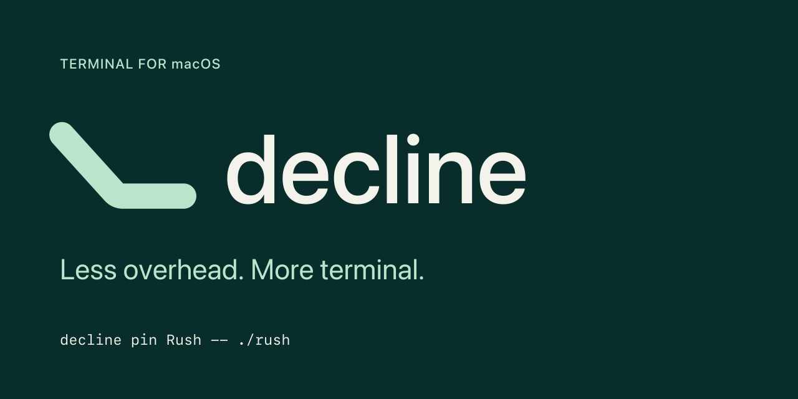
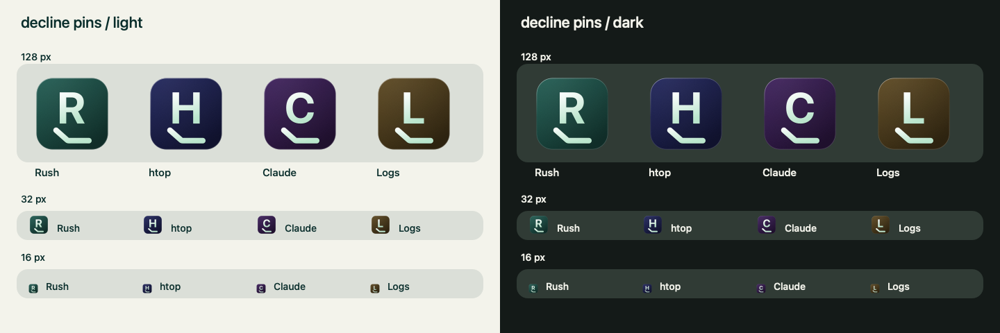

# decline — brand specification

**Less overhead. More terminal.**

Use lowercase **decline**. At first contact, pair the name with **terminal for
macOS**. The identity is the Long rest Slope icon and SF Pro Medium wordmark.



## Icon

A mint line drops, then levels into a long resting segment on spruce. The level
ending suggests a terminal underscore and settled overhead. Keep it still, with
rounded ends; do not add arrowheads, graph axes or a download tray.

The master is 1024 × 1024. Its rounded-square body is 824 × 824 at (100,100),
with corner radius 185. The line is:

```text
M294 400 L484 610 Q497 624 516 624 H738
stroke-width: 92; stroke-linecap: round; stroke-linejoin: round; fill: none
```

Default, Dark and Tinted share the same geometry. Tinted is a monochrome green
appearance reference; a system tint must preserve tonal separation.

| Material | Default | Dark | Tinted |
| --- | --- | --- | --- |
| Body top | `#245950` | `#143B34` | `#265940` |
| Body bottom | `#092D2B` | `#051A17` | `#10291D` |
| Foreground top | `#FFFFFF` | `#FFFFFF` | `#E1F3E9` |
| Foreground bottom | `#B9E5CC` | `#CEF4DF` | `#B8DDC8` |

All colours are sRGB. Primary spruce/ink is `#092D2B`, mint is `#B9E5CC`, and
paper is `#F3F3EB`. Body gradient runs from normalized (0,0) to (.7,1); foreground
from (0,0) to (.3,1). The static icon has a black 22% depth plane offset 14 px,
white top-left light fading from 16% to zero, and an inset 6 px rim with white
opacity .55 / .06 / .22. The outer margin is transparent.

SVG groups separate body, preview depth, foreground and preview lighting. For
Liquid Glass packaging, import flat foreground artwork into Icon Composer and
use system masking, lighting and materials; remove the baked preview depth,
lighting and enclosure mask. The supplied SVGs and PNGs are artwork and static
appearance renders, not compiled `.icon` bundles.

## Pins

A large initial identifies the command. The mint Slope below it identifies the
pin as part of decline. Background colours come from the **fixed ten-entry
palette below**, never a continuously generated hue. Use the same pin artwork
on light and dark Docks; do not change a pin's hue with appearance mode.



### Palette and contrast

The table order is part of the format. Do not sort it by hue or reorder it.
Use the exact hex endpoints for rendering. The HSL values describe their
construction: saturation **48%**, top lightness **24%**, bottom lightness **12%**.
These stay within saturation 42–50%, top lightness 22–26%, and bottom lightness
11–13%. Saturation here is ordinary sRGB HSL, not perceptual OKLCH chroma.
No per-name saturation or lightness variation is applied.

| Index | Hue name | HSL hue | Top | Bottom | Minimum contrast bound |
| ---: | --- | ---: | --- | --- | ---: |
| 0 | Cyan | 180° | `#205B5B` | `#102D2D` | 4.79:1 |
| 1 | Azure | 200° | `#20475B` | `#10232D` | 6.03:1 |
| 2 | Amber | 40° | `#5B4720` | `#2D2310` | 5.41:1 |
| 3 | Violet | 270° | `#3D205B` | `#1F102D` | 8.18:1 |
| 4 | Blue | 220° | `#20335B` | `#101A2D` | 7.50:1 |
| 5 | Teal | 170° | `#205B51` | `#102D28` | 4.85:1 |
| 6 | Indigo | 235° | `#20255B` | `#10122D` | 8.61:1 |
| 7 | Periwinkle | 250° | `#2A205B` | `#15102D` | 8.75:1 |
| 8 | Orchid | 290° | `#51205B` | `#28102D` | 7.50:1 |
| 9 | Plum | 315° | `#5B204C` | `#2D1026` | 7.31:1 |

Both the initial and Slope use `#FFFFFF` → `#B9E5CC`. Pin lighting is capped at
**6% white**, fading to zero, and preview depth is 8 px at 22% black. The inset
rim remains outside the foreground's bounds. Do not use the app icon's 16%
light overlay on pins: it would break the contrast floor for some hues.

The contrast bound compares the darkest foreground, `#B9E5CC`, with the
brightest possible underlay, `0.94 × topRGB + 0.06 × whiteRGB`, componentwise in
sRGB. Every darker gradient position has at least this contrast. Values are
rounded down to two decimals. Linearize each normalized sRGB component `c` as
`c/12.92` when `c ≤ 0.04045`, otherwise `((c+0.055)/1.055)^2.4`; luminance is
`0.2126R + 0.7152G + 0.0722B`. Contrast is `(Ylighter+0.05)/(Ydarker+0.05)`.
The lowest bound is **4.79:1**, above the required 4.5:1. This is solid-ink
contrast, not a claim that antialiased edge pixels meet the same ratio.

### Generation contract: `slope-pins-2`

1. Normalize the display name to Unicode NFC, using Unicode 15.1 tables.
   Trim only Unicode White_Space from both ends: U+0009–000D, 0020, 0085, 00A0,
   1680, 2000–200A, 2028, 2029, 202F, 205F and 3000. Keep internal whitespace.
   Fold ASCII A–Z to a–z; leave all other characters unchanged. This canonical
   name is locale-independent; do not substitute full Unicode case folding.
2. Encode that canonical name as UTF-8 and calculate **FNV-1a 32**:

   ```text
   h = 2166136261                 // unsigned 32-bit
   for byte in canonical_utf8:
       h = ((h XOR byte) * 16777619) mod 4294967296
   index = h mod 10              // zero-based; table order above
   ```

   Use the table's exact top and bottom hex values. No additional hash mixing,
   hue interpolation or collision-dependent reassignment is permitted.
3. For the visible initial, use the NFC-normalized, trimmed original display
   name. Select the first extended grapheme cluster containing a Unicode Letter
   or Number (Unicode 15.1/UAX #29). Uppercase with default Unicode casing,
   retaining the full result if it expands; use `#` if none qualifies.
   Shape **SF Pro Bold**, with system font fallback for unsupported characters.
   Outline the result and proportionally fit its ink bounds into 400 × 360 px
   centred at (512,445). Never insert unescaped user text into SVG.
4. Retain the body grid above and this fixed maker's mark:

   ```text
   M326 702 L452 814 Q460 822 474 822 H704
   stroke-width: 64; stroke-linecap: round; stroke-linejoin: round; fill: none
   ```

   The initial ends at y625; the Slope's nearest edge begins at y670. Keep the
   gap so the two forms remain separate at 16 px. In `pin-template.svg`, replace
   the first foreground path with the new initial and retain the second path;
   update its depth-plane copy too. Update only the body gradient endpoints.
   The supplied template is the concrete Rush example, index 5.
5. Persist the generator version, canonical name, hash, index, outlined initial
   and palette values when creating the pin. Retain these on update and rename
   unless regeneration is requested. Same-initial/same-index collisions remain
   possible: offer a persistent custom glyph or custom icon, rather than
   silently moving existing pins between hues. Keep the full name as the Dock
   label. The four examples below have distinct initials and distinct indices.

| Display name | Canonical UTF-8 text | FNV-1a 32, decimal | Index | Hue | Initial |
| --- | --- | ---: | ---: | --- | --- |
| Rush | `rush` | 20943315 | 5 | Teal, 170° | R |
| htop | `htop` | 3212443446 | 6 | Indigo, 235° | H |
| Claude | `claude` | 3791422743 | 3 | Violet, 270° | C |
| Logs | `logs` | 3473062022 | 2 | Amber, 40° | L |

## Typography and wordmark

The wordmark is lowercase **decline**, **SF Pro Medium**, system kerning,
zero additional tracking. Use the supplied outlined SVG for a fixed rendering;
it requires no installed font. Do not distribute the macOS system font files.

In the 1000 × 260 master, the name is 126 px with text origin x250 and baseline
y179. The mark sits at left with transform `translate(-10,4) scale(.28)`; its
level centreline is y178.72, aligned with the type baseline. There is about
40 px between the mark's right edge and the text origin. Scale the whole lockup
proportionally and keep at least half an x-height clear around it. Never replace
a letter with the mark or put the wordmark inside the Dock icon.

Use spruce `#092D2B` on paper `#F3F3EB`; for an inverse lockup use a paper name
and mint mark on spruce. Product prose is SF Pro Text Regular, 16 px / 24 px;
headings SF Pro Display Medium; commands SF Mono Regular, 14 px / 21 px.

The 1280 × 640 README/social header uses SF Pro Medium 156 px for the name,
SF Pro Regular 46 px for **Less overhead. More terminal.**, SF Pro Medium 22 px
with 1.6 px tracking for the category, and SF Mono Regular 23 px for the command.

## Final asset set

These twelve files constitute the final set, all directly in `docs/brand/`:

| File | Purpose / dimensions |
| --- | --- |
| [README.md](README.md) | This specification |
| [icon.svg](icon.svg) | Default master, 1024 × 1024 |
| [icon.png](icon.png) | Default render, 1024 × 1024 |
| [icon-dark.svg](icon-dark.svg) | Dark master, 1024 × 1024 |
| [icon-dark.png](icon-dark.png) | Dark render, 1024 × 1024 |
| [icon-tinted.svg](icon-tinted.svg) | Tinted master, 1024 × 1024 |
| [icon-tinted.png](icon-tinted.png) | Tinted render, 1024 × 1024 |
| [pin-template.svg](pin-template.svg) | Generated-pin template shown as Rush, 1024 × 1024 |
| [pins.png](pins.png) | Light/dark Dock strips at actual 128/32/16 px, 1440 × 480 |
| [wordmark.svg](wordmark.svg) | Outlined Medium lockup, 1000 × 260 |
| [wordmark.png](wordmark.png) | Lockup render, 1000 × 260 |
| [readme-header.png](readme-header.png) | README/social artwork, 1280 × 640 |

PNGs are rendered with Swift/AppKit on macOS and visually checked at their
intended sizes. Icon PNGs preserve transparent corners. The pin comparison uses
identical pin artwork on light and dark backgrounds, without enlarging the 16 px
samples. The specification governs the artwork; Rust pin-generation and app
bundle integration are separate implementation work.
